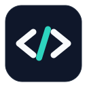
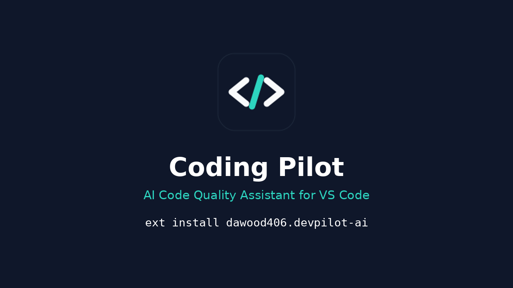

<div align="center">



# Coding Pilot

**Your AI-powered co-pilot for code quality in VS Code.**

*Scan. Fix. Test. Document. — in 24 languages, in your original file, with your confirmation.*

[](https://marketplace.visualstudio.com/items?itemName=dawood406.devpilot-ai)
[](https://marketplace.visualstudio.com/items?itemName=dawood406.devpilot-ai)
[](#-supported-languages)
[](#-commands)
[](LICENSE)
[](https://marketplace.visualstudio.com/items?itemName=dawood406.devpilot-ai)

[Install](#-quickstart) · [Features](#-features) · [Languages](#-supported-languages) · [Docs](#-how-it-works) · [FAQ](#-faq) · [Marketplace](https://marketplace.visualstudio.com/items?itemName=dawood406.devpilot-ai) · [GitHub](https://github.com/datascientist970/devpilot)

</div>

---

## 🎬 Watch it in 60 seconds

<video src="video/coding-pilot-60s.mp4" poster="video/coding-pilot-poster.png" width="100%" controls></video>

[](video/coding-pilot-60s.mp4)

> *The tour above is an AI-generated product video with the Coding Pilot logo and install command. For a real screen recording of the extension in action, see the roadmap below.*

---

## ✨ What it does — in three steps

| Step | What happens | Example |
| --- | --- | --- |
| **01 · Scan** | One click scans your project or file with built-in analyzers — bugs, security issues, type problems, quality and naming. | `DevPilot: Scan Project` finds 16 issues in a file |
| **02 · Fix** | Pick a fix, preview it, confirm it. It is applied **in your original file**, syntax-checked first, then the file is re-scanned. | A mutable-default-argument bug, fixed where it lives |
| **03 · Test & Document** | Generate tests (full, edge-case, input-validation or regression), run them, verify the fix, generate docs and a README. | `pytest`: 22 passed, 1 failed — and why it failed |

**If a linter is an employee, Coding Pilot is the team.** It does not just point at problems — it helps you clear them, prove the fix, and document the result.

---

## ✅ Coding Pilot is right for you if

- ✅ You write in **more than one language** and are tired of a different linter for each one
- ✅ You want **AI help, but with confirmation** — nothing is changed silently
- ✅ You want fixes in the **original file**, not in a temp document or a diff you have to copy back
- ✅ You want **tests and docs generated**, not just issues listed
- ✅ You work **without an AI key too** — local analysis, local fixes and local docs still work
- ✅ You want to know **why a fix is safe** — syntax validation and a re-scan after every fix

---

## 🚀 Features

| | | |
| --- | --- | --- |
| **🔍 Deep analysis**<br>Static analysis, bug detection, naming checks, unused variables & functions, undefined variables, complexity and duplicate code. | **🛡️ Security checks**<br>`eval`/`exec`, unsafe C functions, hardcoded secrets, SQL-injection patterns and unsafe deserialization. | **🤖 AI assistance**<br>Explain an issue or selected code, root-cause analysis, AI code review, security review, optimisation and refactoring. |
| **✏️ Intelligent fixing**<br>Fix this, fix all, fix selected — deterministic local fix first where one is safe, then AI candidates. Confirmation + syntax validation before applying. | **🧪 Test generation & running**<br>Full, edge-case, input-validation and regression test modes. pytest, Jest/Vitest, JUnit, `go test`, cargo test, PHPUnit and more. | **📄 Documentation**<br>Function, class, module and README generation — AI-powered, or local comments when no AI key is configured. |
| **🧰 Testing tools**<br>Tick Playwright, Cypress, Postman, JMeter and more in Settings and they auto-run on `Run Tests`. SaaS/management tools are reported as external — never faked as a pass. | **📦 Dependency checks**<br>`Check & Install Missing Dependencies` finds missing imports/includes, verifies them for real, and installs only after your confirmation. Test pre-flight checks pytest / `node_modules` first. | **📊 Project health**<br>Sidebar with Actions, Project Health and issue categories (Bugs, Naming, Type, Security, Quality, Testing, Documentation), plus Problems-panel diagnostics and Quick Fix. |

---

## ❌ Without Coding Pilot vs ✅ With Coding Pilot

| Without Coding Pilot | With Coding Pilot |
| --- | --- |
| ❌ A different linter per language, each configured separately | ✅ One engine, **24 languages**, built-in — external tools are optional extras |
| ❌ Issues listed, fixing left to you | ✅ Fix suggestions with confirmation, applied in the original file |
| ❌ A fix that breaks the build | ✅ Syntax validation before applying, re-scan after, applied/skipped/failed reported |
| ❌ Tests written by hand, or not at all | ✅ Tests generated in four modes, run and reported in the output channel |
| ❌ No AI key = no help | ✅ Local analysis, fixes, docs and test templates work with no key at all |
| ❌ "Which tool do I need for this language?" | ✅ Dependency check tells you what is missing — and installs it, or gives you the link |

---

## 💡 Why Coding Pilot is different

| | |
| --- | --- |
| **Fixes land in the original file** | No temp document, no diff to copy back. `WorkspaceEdit`, auto-save, re-scan. |
| **Confirmation is the default** | Every fix asks first (configurable). Every dependency install asks first. |
| **Honest reporting** | A tool is only reported as run when its command actually ran. SaaS tools are reported as *external*, never as a fake pass. |
| **No key, no problem** | Without OpenAI / Gemini / Claude / Groq configured, everything local still works. Keys live in VS Code Secret Storage, never in settings files. |
| **Progress you can see** | Scan, test and dependency checks show a progress bar with % and elapsed time. |
| **Built-in first** | Ruff, Mypy, cppcheck, clang-tidy and ESLint are optional. If a tool is missing, the built-in analyzer still scans. |

---

## 🌍 Supported languages

Python · C · C++ · JavaScript · TypeScript · JSX · TSX · Java · C# · Go · Rust · PHP · Ruby · Swift · Kotlin · Dart · Lua · SQL · HTML · CSS · R · Scala · Perl · Jupyter Notebook (`.ipynb`)

| Language | Optional external tool |
| --- | --- |
| Python | Ruff, Mypy, `py_compile` |
| C / C++ | cppcheck, clang-tidy, `gcc` / `g++ -fsyntax-only` |
| JavaScript / TypeScript | ESLint |
| Go | `go vet` |
| Rust | `rustc` |
| PHP | `php -l` |
| Ruby | `ruby -c` |
| Perl | `perl -c` |
| R | Rscript parse |
| Jupyter Notebook | JSON + Python `py_compile` of its code cells |

HTML, CSS, SQL and Jupyter have dedicated analyzers — HTML (unclosed/mismatched tags, duplicate id, img without alt), CSS (duplicate selector/property, empty rule, `!important`), full SQL (SELECT \*, DELETE/UPDATE without WHERE, missing PRIMARY KEY, JOIN without ON), and Jupyter cell scanning mapped to the exact `.ipynb` line, with cross-cell variables not falsely flagged.

---

## ⚡ Quickstart

```bash
ext install dawood406.devpilot-ai
```

Or search **"Coding Pilot"** in the VS Code Extensions view.

1. Open a project, then run **DevPilot: Scan Project** (`Ctrl+Alt+S`) or **DevPilot: Scan Current File** from the sidebar.
2. Click an issue in the sidebar to jump to it, or use the lightbulb (Quick Fix) on a flagged line.
3. Optional: run **DevPilot: Configure AI Provider** and paste an API key — stored securely by VS Code. Without it, static analysis, local fixes, local docs and local test templates still work.
4. Try **DevPilot: Generate Tests**, **DevPilot: Run Tests** and **DevPilot: Generate Documentation** on an open file.

---

## 🔧 How it works

```
Scan → Diagnose → Explain → Suggest → Preview & Apply → Test → Verify → Document
```

- **Analysis** — one built-in engine plus optional external tools. Issues carry codes (e.g. `DP601` for a missing local `#include`) so you can look up exactly what was flagged.
- **Fixing** — a deterministic local fix first where one is safe (e.g. bare `except:` → `except Exception:`), then AI candidates with related files (imports/includes) sent as context. Confirmation, syntax validation (`py_compile`, `node --check`, `g++ -fsyntax-only`, delimiter balance), apply, auto-save, re-scan, report.
- **Testing** — generate tests in Full / Edge-case / Input-validation / Regression mode, run with the detected runner, tick extra tools in `devpilot.test.enabledTools`. Run the current file for a runtime check (Python, Node, Go, Ruby, PHP, Lua, Perl, R, Scala, C/C++, Java, Rust, Jupyter via extracted Python).
- **Dependencies** — `Check & Install Missing Dependencies` parses `#include` / imports, verifies them for real (never offers system headers or the Python standard library for install), and installs pip/npm directly or apt via a visible terminal — only after your confirmation, or gives you the official link when there is no install command.

---

## ⌨️ Commands

<details>
<summary><b>All 38 commands (click to expand)</b></summary>

`Scan Project` · `Scan Current File` · `Fix Current Issue` · `Fix All Issues in File` · `Fix Selected Issues` · `Auto Fix with AI` · `Suggest Fixes` · `Explain Issue` · `Explain Selected Code` · `Analyze Bug` · `AI Code Quality Review` · `Security Review` · `Optimize Code` · `Refactor Code` · `Generate Tests` · `Generate Edge Case Tests` · `Generate Input Validation Tests` · `Generate Regression Tests` · `Run Tests` · `Run Current File` · `Verify Fix` · `Generate Documentation` · `Generate README` · `Export Scan Report` · `Check & Install Missing Dependencies` · `Configure AI Provider` · `Remove Stored AI Key` · `Configure Test Tools` · `Open Settings` · `Refresh` — all under the `DevPilot:` prefix in the Command Palette.

</details>

---

## ⚙️ Settings

<details>
<summary><b>Key settings (click to expand)</b></summary>

| Setting | Default | Meaning |
| --- | --- | --- |
| `devpilot.ai.provider` | `none` | `openai`, `gemini`, `claude`, `groq` or `none` |
| `devpilot.ai.model` | _(provider default)_ | Model name |
| `devpilot.scan.onSave` | `false` | Scan the current file on save |
| `devpilot.scan.exclusions` | node_modules, .venv, dist, … | Excluded globs |
| `devpilot.diagnostics.enabled` | `true` | Publish to the Problems panel |
| `devpilot.enable.ruff` / `enable.mypy` | `true` | Python external tools |
| `devpilot.enable.externalTools` | `true` | cppcheck, clang-tidy, ESLint, … |
| `devpilot.fix.requireConfirmation` | `true` | Confirm before applying a fix |
| `devpilot.fix.validateSyntax` | `true` | Validate syntax before applying a fix |
| `devpilot.dependencies.autoInstall` | `false` | Install dependencies without asking (off by default) |
| `devpilot.dependencies.checkBeforeTests` | `true` | Check dependencies before running tests |
| `devpilot.test.enabledTools` | `[]` | Ticked testing tools to auto-run on Run Tests |
| `devpilot.test.customCommands` | `{}` | Custom command per tool, e.g. Selenium / Appium / Insomnia |
| `devpilot.analysis.complexityThreshold` | `10` | Complexity flag threshold |
| `devpilot.analysis.longFunctionLines` | `50` | Long-function threshold |
| `devpilot.analysis.maxLineLength` | `120` | Long-line threshold |

Legacy setting names from v0.1.0 (`devpilot.pythonPath`, `devpilot.enableRuff`, …) are still read as fallbacks.

</details>

---

## ❓ FAQ

**Q: Does it work without an AI API key?**
A: Yes. Static analysis, local fixes, local docs and local test templates all work with no key. AI review, AI fixes and AI-generated tests need a provider configured via `DevPilot: Configure AI Provider`.

**Q: Where is my API key stored?**
A: In VS Code Secret Storage. Never in a settings file, never in your code.

**Q: Will it change my code without asking?**
A: No. Fixes ask for confirmation by default, are syntax-checked before applying, and the file is re-scanned afterwards. Dependency installs also ask first.

**Q: Which languages are supported?**
A: 24 — Python, C, C++, JavaScript, TypeScript, JSX, TSX, Java, C#, Go, Rust, PHP, Ruby, Swift, Kotlin, Dart, Lua, SQL, HTML, CSS, R, Scala, Perl and Jupyter Notebook (`.ipynb`).

**Q: Why is it called Coding Pilot on the Marketplace but DevPilot inside VS Code?**
A: The Marketplace display name is **Coding Pilot** (`dawood406.devpilot-ai`); the sidebar and commands still say **DevPilot**. Same extension, same version (1.4.1).

**Q: How is this different from a linter?**
A: A linter lists problems. Coding Pilot lists them, explains them, fixes them in place with your confirmation, generates tests to prove the fix, and documents the result.

---

## 🛠️ Development

```sh
npm install
npm run compile        # builds dist/extension.js with esbuild
npm run test:analysis  # pure analyzer checks (no VS Code needed)
```

Press `F5` in VS Code to launch the Extension Development Host.

---

## 🗺️ Roadmap

- ✅ **v1.4.1** — Empty issue categories expand with a "No … issues" note; AI Code Quality Review warns instead of silently doing nothing with no provider.
- ✅ **v1.4.0** — Dependency checks & install, test pre-flight, progress bars with % and elapsed time.
- ⚪ **Planned** — A real screen recording of the extension (replacing the AI-generated tour video above).
- ⚪ **Planned** — More languages and analyzers, based on feedback — tell us what you need in [Issues](https://github.com/datascientist970/devpilot/issues).

---

## 🤝 Contributing

Issues and pull requests are welcome. Please open an issue first for a new feature so it can be discussed before you build it.

---

## 👤 Author

**Muhammad Dawood** — [GitHub @datascientist970](https://github.com/datascientist970) · [LinkedIn dawood406](https://www.linkedin.com/in/dawood406)

---

## 📜 License

MIT — see [LICENSE](LICENSE).

---

<div align="center">

**If Coding Pilot saves you time, please ⭐ star the repo and leave a review on the [Marketplace](https://marketplace.visualstudio.com/items?itemName=dawood406.devpilot-ai).**


*Scan. Fix. Test. Document.*

</div>
